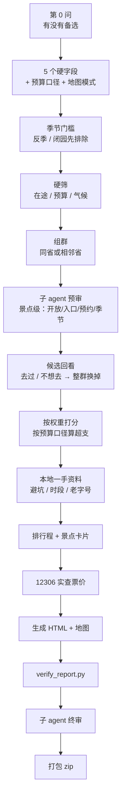

# travel-recommend

把一个「放假去哪玩」的模糊念头，变成一份**能直接照着订票**的离线图文报告。

不是列十个网红城市，而是：问清条件 → 排除不可行的 → 按你的权重打分 → 只查实价 → 输出双击就能打开的 HTML 文件夹（行程、景点实景图、车次票价、费用表、路线地图）。

- 版本：**1.6.0**｜许可：MIT
- 方法论在 [`travel-recommend/SKILL.md`](travel-recommend/SKILL.md)，本文只讲**怎么用、产出什么、边界在哪**

---

## 什么时候用它

| 你会这样说 | 它做什么 |
|---|---|
| 「国庆 5 天，从杭州出发，能去哪？」 | 按假期长度圈定半径，给出若干互斥的地点群 + 每个群的完整方案 |
| 「我和朋友一个在北京一个在广州，去哪会合？」 | 先问预算怎么算：共同 / 各自 / 统一；不默认把一个人的上限强加给另一个人 |
| 「预算 4000 一个人，够去哪？」 | 先砍预算不可行的目的地；**你点名的地方不砍**，写清会超多少 |
| 「我们之前聊过想去敦煌」 | 敦煌必须进候选，并单独出一份完整方案 |
| 「这些地方我去过一半了」 | 深挖前先给你过目，去过/不想去的**整群换掉** |
| 「7 月想去哈尔滨」 | 过季节门槛；冰雪大世界非当季会显著提示，而不是硬排进行程 |

不适用的场景：只想要一张景点清单（太重）、已经在目的地只想排市内路线（用地图 App 更快）、需要代订票（本 skill 只查价不代购）。

---

## 一分钟上手

```text
用 travel-recommend 帮我规划：国庆 5 天，我从杭州东出发，朋友从广州南出发，人均 4000
```

Agent 会先问几轮（不是一次性甩 12 个问题）：

1. **第 0 问**：你们之前聊过想去哪？有没有备选？——有的话必须进候选。
2. **5 个硬字段**：出发地（车站/机场）、同行者与各自出发地、日期与浮动天数、总天数、人均预算上限。
3. **预算口径**：共同总预算 / 各自上限 / 统一上限——两个人的距离和收入不同，不能默认按最差者算。
4. **地图模式**：离线 SVG（默认，双击即开）/ 高德 key（需联网，用户自己申请）。

问清后复述一遍给你确认，然后才开始干活。**缺任何一项都会停下来问，不会拿示例数据糊一份给你。**

---

## 流程



写死的几个硬步骤：

- **C 季节门槛**：每个群有 `seasonStatus`（ok/off/closed）；反季标 `off`，闭园直接淘汰。
- **F 预审**：提示词在 `travel-recommend/prompts/season-factcheck.md`，必须核到**每个景点**：当前是否开放、从哪个门进、停止入场时间、预约方式、季节错配。
- **G 候选回看**：先把群清单给你看，问「哪些去过、哪些不想去」。去过的整群替换。
- **N 终审**：提示词在 `travel-recommend/prompts/final-review.md`，`FAIL` 必须修完再打包。

---

## 产出物

```
travel-report/
├─ index.html          # 双击就开，不联网（amap 模式除外）
├─ css/style.css
├─ js/data.js          # ★ 只有这个要改：画像 / 群 / 行程 / 票价 / 署名
├─ js/app.js           # 渲染逻辑
├─ images/             # 实景图（每个景点 ≥2 张，上不封顶）+ 逐张署名
└─ README.md           # 数据来源、假设清单、怎么改
```

报告里有什么：

- **地点群评分表**：7 个维度加权；标出季节状态、是否你点名、超预算多少
- **每个群一套完整方案**：逐日行程、景点卡片（介绍 + 门票 + 时长 + 开放时间 + **状态 + 入口** + 怎么去 + 一条实用提示）、往返车次与票价、费用计算器
- **景点级季节警示**：闭园/非当季的景点有 badge，方案顶部有 alert；反季不会只藏在提示里
- **票价三件套**：查询时间 + 参考乘车日 + 「实查 / 估算」；未开售明确写「尚未开售」，不会伪装成「无车」
- **路线地图**：默认按真实经纬度投影的 SVG；有高德 key 可切在线地图，失败自动回退
- **费用计算器**：改人数 / 房价即时重算；按 `shared / per_person / uniform` 分别判断超支

---

## 目录

以下路径相对本 README 所在目录（skill 本体在 `travel-recommend/` 里）：

| 路径 | 作用 |
|---|---|
| `travel-recommend/SKILL.md` | 方法论：输入契约、季节门槛、组群、评分、票价纪律、验证清单、反模式 |
| `travel-recommend/prompts/season-factcheck.md` | 给用户看名单前的景点级事实核查提示词 |
| `travel-recommend/prompts/final-review.md` | 交付前的整体审核提示词 |
| `travel-recommend/assets/report-template/` | 报告模板，空数据也能打开；含 4 张 SVG 占位图 |
| `travel-recommend/scripts/fetch_rail_fares.py` | 12306 车次 + 各席别实价（自动 cookie、核对上车站） |
| `travel-recommend/scripts/fetch_images.py` | Commons 批量抓图；Pillow 校验、md5 去重、自动署名 |
| `travel-recommend/scripts/verify_report.py` | 静态自检：图片/署名/价格/季节/预算口径/群↔方案映射 |
| `travel-recommend/scripts/package_report.py` | 先自检再打 zip，保留顶层目录 |
| `travel-recommend/scripts/calc_budget.py` | 与页面同公式的预算复算 |
| `travel-recommend/scripts/lib.py` | 公共函数（requests 会话、重试、md5、署名清洗） |

---

## 手动跑脚本

脚本用 Python 3.11+，依赖写在 PEP 723 头里，`uv` 自动安装，不需要手动 pip。

```bash
cd travel-recommend

# 车次票价（超出 15 天预售期会提示「未开售」，不是「无车」）
uv run --no-project scripts/fetch_rail_fares.py 上海虹桥 黄山北 2026-11-25

# 抓图：清单每行 slug|Commons 文件名|宽度
uv run --no-project scripts/fetch_images.py ../travel-report/images manifest.tsv --sleep 4

# 增量补图（保留已有 credits）
uv run --no-project scripts/fetch_images.py ../travel-report/images more.tsv --keep-credits

# 自检 → 打包
uv run --no-project scripts/verify_report.py ../travel-report
uv run --no-project scripts/package_report.py ../travel-report out.zip
```

依赖：`uv`（自动选 Python）。不再需要 curl / jq / node / Git Bash；Windows 的 `cmd` 或 PowerShell 也能直接调 `uv`。

---

## 这份 skill 的取舍

| 它坚持 | 为什么 |
|---|---|
| 缺字段就问，不问清不产出 | 用示例数据填出来的方案，订票时全废 |
| 每个价格带查询时间与来源 | 「大概 500 块」是最没用的一句话 |
| 先问预算口径，不默认取最差者 | 两个人的距离和收入不同，一个人的上限不该强加给另一个人 |
| 先过季节门槛 | 夏天推冰雪大世界、雨季推峡谷，攻略写得再好也是错 |
| 景点级核验开放/入口/停止入场 | 「到了发现关门」「走错门多绕 1 小时」是最高频的踩坑 |
| 一个群内的城市同省或相邻省 | 跨半个中国拼出来的「群」，车上时间比玩的时间长 |
| 每个群都给完整方案 | 只给首选写详情，等于替用户做了选择 |
| 图片越多越好，2 张只是下限 | 凑够 2 张就收手，读起来像目录 |
| 地图默认内嵌 SVG | Leaflet/OSM 瓦片要联网或几十 MB；高德 key 作为可选增强 |

---

## 已知边界

- **SVG 地图是示意投影**，不是瓦片底图：能看清「谁在谁东北、几段路怎么连」，看不到街道。要真实底图用 `mapMode: "amap"` + 自己的 key，但需联网，且 `file://` 可能被 key 的域名白名单限制。
- **12306 预售期约 15 天**：远期价格取同车次近期实价，报告写明参考乘车日，并提示放票后可能上浮。
- **机票、住宿、部分门票是估算**：标 `estimated` 并给区间，不编造精确数字。
- **景点开放状态会临时变**：大风封天池、临时闭馆、索道检修都可能发生；报告给的是核对时点的状态，出发前再看一眼官方公告。
- **单城深度游**不是它的强项：价值在「多个候选群之间做比较」。

---

## 用之前

报告是决策参考，不是预订承诺。票价、门票、开放时间都会变；下单前以官方渠道为准，尤其节假日。
