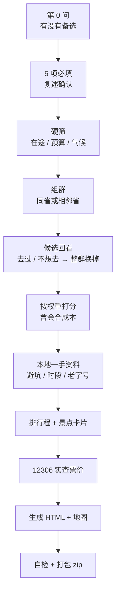

# travel-recommend

把一个「放假去哪玩」的模糊念头，变成一份**能直接照着订票**的离线图文报告。

不是给你列十个网红城市，而是：问清条件 → 排除不可行的 → 按你自己的权重打分 → 只查实价 → 输出一个双击就能打开的 HTML 文件夹（含行程、景点实景图、车次票价、费用表、路线地图）。

- 版本：**1.5.0**｜许可：MIT
- 方法论在 [`SKILL.md`](travel-recommend/SKILL.md)，本文只讲**怎么用、产出什么、边界在哪**

---

## 什么时候用它

| 你会这样说 | 它做什么 |
|---|---|
| 「国庆 5 天，从杭州出发，能去哪？」 | 按假期长度圈定半径，给出若干互斥的地点群 + 每个群的完整方案 |
| 「我和朋友一个在北京一个在广州，去哪会合？」 | 按**最吃亏的那个人**算会合成本，而不是取平均 |
| 「预算 4000 一个人，够去哪？」 | 先砍预算不可行的目的地，再谈体验 |
| 「我们之前聊过想去敦煌」 | 敦煌必须进候选，并单独出一份完整方案 |
| 「这些地方我去过一半了」 | 深挖前先给你过目，去过/不想去的**整群换掉** |

不适用的场景：只想要一张景点清单（太重）、已经在目的地只想排市内路线（用地图 App 更快）、需要代订票（本 skill 只查价不代购）。

---

## 一分钟上手

```text
用 travel-recommend 帮我规划：国庆 5 天，我从杭州东出发，朋友从广州南出发，人均 4000
```

（Agent 会自动识别这个 skill；也可以直接把需求说全，只要包含日期、天数、出发地、同行者、预算。）

它会先问两轮（不是一次性甩 12 个问题）：

1. **第 0 问**：你们之前聊过想去哪？有没有备选？——有的话必须进候选。
2. **5 个必填**：出发地（车站/机场）、同行者与各自出发地、日期与浮动天数、总天数、人均预算上限。

问清后复述一遍给你确认，然后才开始干活。**缺任何一项它都会停下来问，不会拿示例数据糊一份给你。**

---

## 流程



两个容易踩空的点，已经写成硬步骤：

- **E 候选回看**：先把群清单给你看，问「哪些去过、哪些不想去」。去过的整群替换——去过一次的人不会为隔壁城市再飞一趟。这一步之前不查攻略，避免白干。
- **G 本地资料**：风土人情和景点提示必须来自本地人写的内容，不用模型记忆和百科改写。

---

## 产出物

```
travel-report/
├─ index.html          # 双击就开，不联网
├─ css/style.css
├─ js/data.js          # ★ 只有这个要改：画像 / 群 / 行程 / 票价 / 署名
├─ js/app.js           # 渲染逻辑
├─ images/             # 实景图（每个景点 ≥2 张，上不封顶）+ 逐张署名
└─ README.md           # 数据来源、假设清单、怎么改
```

报告里有什么：

- **地点群评分表**：7 个维度的加权分，点一下换权重预设（人文美食 / 省心省钱 / 亲子自然）就重排
- **每个群一套完整方案**：逐日行程（带时间块）、景点卡片（介绍 + 门票 + 时长 + 开放时间 + 怎么去 + 一条实用提示）、往返车次与票价、费用计算器
- **票价三件套**：查询时间 + 参考乘车日 + 「实查 / 估算」标记；未开售会明确写「尚未开售」，不会伪装成「无车」
- **SVG 路线地图**：按真实经纬度投影画的城市与景点位置、连接线
- **费用计算器**：改人数 / 房价即时重算，并可和 `calc_budget.sh` 对账

---

## 目录

以下路径相对本 README 所在目录（skill 本体在 `travel-recommend/` 里）：

| 路径 | 作用 |
|---|---|
| `travel-recommend/SKILL.md` | 方法论：输入契约、组群、评分、票价纪律、验证清单、反模式 |
| `travel-recommend/assets/report-template/` | 报告模板，空数据也能打开；含 4 张 SVG 占位图 |
| `travel-recommend/scripts/fetch_rail_fares.sh` | 12306 车次 + 各席别实价（自动带 cookie、核对上车站） |
| `travel-recommend/scripts/fetch_images.sh` | Wikimedia Commons 批量抓图，自动生成署名 |
| `travel-recommend/scripts/verify_report.sh` / `.mjs` | 交付前静态自检 |
| `travel-recommend/scripts/package_report.sh` | 先自检再打 zip |
| `travel-recommend/scripts/calc_budget.sh` | 与页面同公式的预算复算 |
| `travel-recommend/scripts/lib.sh` | 公共函数（UA、重试、md5） |

---

## 手动跑脚本

```bash
cd travel-recommend/scripts

# 车次票价（超出 15 天预售期会明确提示「未开售」，不是「无车」）
./fetch_rail_fares.sh 上海虹桥 黄山北 2026-11-25

# 抓图：清单每行 slug|Commons 文件名|宽度
./fetch_images.sh ../travel-report/images manifest.tsv

# 自检 → 打包
./verify_report.sh ../travel-report
./package_report.sh ../travel-report out.zip
```

**Windows 注意**：不要写 `bash script.sh`——在部分机器上 `bash` 会解析到 `C:\Windows\System32\bash.exe`（WSL 存根），表现为一段乱码的 WSL 安装提示。从 `scripts/` 目录里直接 `./script.sh` 即可。

依赖：`curl`、`jq`；完整自检另需 `node` 或 `bun`。抓图被限流时用 `SLEEP=45 ./fetch_images.sh ...` 放慢节奏。

---

## 这份 skill 的取舍

| 它坚持 | 为什么 |
|---|---|
| 缺字段就问，不问清不产出 | 用示例数据填出来的方案，订票时全废 |
| 每个价格带查询时间与来源 | 「大概 500 块」是最没用的一句话 |
| 多出发地取**最差值** | 平均 5.5 小时，可能是你 9 小时 + 对方 2 小时 |
| 一个群内的城市同省或相邻省 | 跨半个中国拼出来的「群」，车上时间比玩的时间长 |
| 每个群都给完整方案 | 只给首选写详情，等于替用户做了选择 |
| 图片越多越好，2 张只是下限 | 凑够 2 张就收手，读起来像目录 |
| 地图用内嵌 SVG，不引 CDN | Leaflet/高德都要联网或 key，`file://` 打开就是白板 |

---

## 已知边界

- **地图是示意投影**，不是瓦片底图：能看清「谁在谁东北、几段路怎么连」，看不到街道。要真实底图必须联网或打包几十 MB 瓦片，与「双击即开」冲突。
- **12306 预售期约 15 天**：远期出行的价格取同车次近期实价，报告里会写明参考乘车日，并提示放票后可能上浮。
- **机票、住宿、部分门票是估算**：会标 `estimated` 并给区间，不编造精确数字。
- **单城深度游**不是它的强项：它的价值在「多个候选群之间做比较」。

---

## 用之前

报告是决策参考，不是预订承诺。票价、门票、开放时间都会变；下单前以官方渠道为准，尤其节假日。
