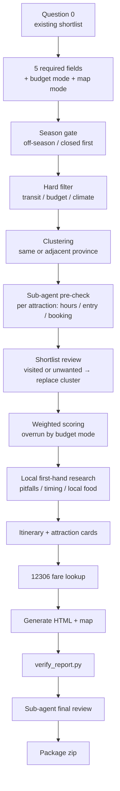

# chinese-travel-recommend

**English** · [简体中文](README.zh-CN.md)

Turn a vague "where should we go for the holiday?" into a **bookable, offline, illustrated HTML report**.

It does not hand you a list of ten trending cities. It asks the questions that actually decide the trip, filters out destinations that cannot work, scores the rest against *your* weights, quotes only prices it really looked up, and ships a folder you double-click (itinerary, real photos, rail/air prices, cost table, route map).

Built for travel inside mainland China: it knows the 12306 presale window, Chinese holiday pricing, and carries a queryable library of 163 domestic attractions.

- Version: **1.8.3** · License: MIT
- Methodology lives in [`chinese-travel-recommend/SKILL.md`](chinese-travel-recommend/SKILL.md); this file covers **how to use it, what it produces, and where it stops**

---

## When to use it

| You say | It does |
|---|---|
| "5 days off around National Day, leaving from Hangzhou — where can we go?" | Bounds the radius by trip length, proposes mutually exclusive location clusters, each with a full plan |
| "I'm in Beijing, my friend is in Guangzhou — where should we meet?" | Asks how to split the budget first (shared / per-person caps / uniform cap) instead of forcing one person's cap on the other |
| "¥4,000 per person — is that enough?" | Drops destinations that fail the budget check; **places you named are kept**, with the overrun spelled out |
| "We talked about going to Dunhuang" | Dunhuang must appear as a candidate with its own complete plan |
| "I've already been to half of these" | Shows the shortlist before digging; visited/disliked clusters are replaced as a whole |
| "Harbin in July" | Runs the season gate; Ice World is flagged off-season instead of being quietly scheduled |

Not a good fit: a plain list of attractions (too heavy), in-city routing only (a maps app is faster), or booking on your behalf (this skill checks prices, it does not purchase).

---

## Quick start

```text
Use chinese-travel-recommend to plan: 5 days off, I leave from Hangzhou East,
my friend from Guangzhou South, budget ¥4,000 per person.
```

The agent asks a few rounds of questions — not twelve at once:

1. **Question 0**: have you and your companion already talked about places you want to go? Any shortlist? Everything mentioned must become a candidate.
2. **Five required fields**: origin (city + station/airport), companions and their origins, dates and float, total days, budget cap.
3. **Budget mode**: shared total / per-person caps / uniform cap — two people rarely have the same distance or income.
4. **Map mode**: offline SVG (default, opens by double-click) or an AMap JS API key (needs network, user-provided).

Then it restates all six confirmations and waits for your OK. **Missing any field stops the process — it will not fill gaps with sample data.**

Requirements: [`uv`](https://docs.astral.sh/uv/) and Python 3.11+. Every script declares its own dependencies in a PEP 723 header, so `uv` installs them on the fly; no `pip install`, no Node, no Git Bash required.

---

## Flow



Non-negotiable steps:

- **Season gate** — every cluster carries `seasonStatus` (`ok` / `off` / `closed`); off-season is marked, closed is dropped.
- **Pre-check** — prompt at `chinese-travel-recommend/prompts/season-factcheck.md`, verified **per attraction**: open today, which gate, last entry, booking method, season mismatch.
- **Shortlist review** — the cluster list goes to you before research; visited or unwanted clusters are replaced whole.
- **Final review** — prompt at `chinese-travel-recommend/prompts/final-review.md`; a `FAIL` must be fixed before packaging.

---

## What you get

```
travel-report/
├─ index.html          # opens offline (except amap mode)
├─ css/style.css
├─ js/data.js          # ★ the only file to edit: profile / clusters / itinerary / fares
├─ js/app.js           # rendering logic
├─ images/             # 4–6 per attraction (6–10 for landmarks), no attribution needed
└─ README.md           # sources, assumptions, how to edit
```

Inside the report:

- **Cluster scorecard**: seven weighted dimensions, season status, whether you named it, budget overrun.
- **A complete plan per cluster**: day-by-day itinerary, attraction cards (intro + ticket + duration + hours + **status + gate** + how to get there + one practical tip), rail/flight options with fares, cost calculator.
- **Attraction-level season warnings**: closed or off-season items get a badge and a top-of-plan alert — never buried in a tip.
- **Fare provenance**: query time + reference travel date + verified/estimated, plus "not yet on sale" instead of "no train".
- **Route map**: SVG projected from real coordinates by default; AMap only with the user's key, with automatic fallback.
- **Cost calculator**: changing headcount or room rate recomputes instantly; overrun is judged under `shared` / `per_person` / `uniform`.

---

## Repository layout

Paths are relative to this README; the skill itself lives in `chinese-travel-recommend/`.

| Path | Purpose |
|---|---|
| `chinese-travel-recommend/SKILL.md` | Methodology: input contract, season gate, clustering, scoring, fare discipline, checklist, anti-patterns |
| `chinese-travel-recommend/prompts/season-factcheck.md` | Per-attraction fact-check prompt used before showing the shortlist |
| `chinese-travel-recommend/prompts/final-review.md` | Whole-report review prompt used before delivery |
| `chinese-travel-recommend/assets/report-template/` | Report template, opens with empty data; includes four SVG placeholders |
| `chinese-travel-recommend/assets/attractions/` | Attraction library: `attractions.jsonl` (163 entries), `curated.jsonl`, field docs |
| `chinese-travel-recommend/scripts/` | Python toolchain (see below) |

### Toolchain

| Script | Purpose |
|---|---|
| `build_attractions.py` | Scrape public rankings → parse → dedupe → tag → enrich intros → JSONL |
| `attractions.py` | Query the library by province/type/tag/keyword; exclude visited, find alternatives; `--all --format compact` dumps the whole pool |
| `fetch_rail_fares.py` | 12306 trains and per-class fares, with cookie handling and real departure-station checks |
| `fetch_images.py` | Bulk Commons download by exact file name; rate limit, retry, md5 dedupe |
| `fetch_images_search.py` | Multi-source image search (Commons / Commons categories / Openverse / Wikipedia lead image); no topic filtering — the AI inspects every image |
| `fetch_geo.py` | Name → coordinates (Wikipedia coordinates, Wikidata P625 fallback) |
| `optimize_images.py` | Downscale/compress images before packaging |
| `verify_report.py` | Static self-check: files, images, duplicate images, external links, placeholders, price structure |
| `package_report.py` | Self-check then zip, keeping the top-level folder |
| `calc_budget.py` | Recompute the budget with the same formula as the page |
| `lib.py` | Shared helpers (HTTP session, retry, md5) |

---

## Running scripts manually

```bash
cd chinese-travel-recommend

# Rail fares (beyond the ~15-day 12306 presale window it reports "not on sale", not "no train")
uv run --no-project scripts/fetch_rail_fares.py 上海虹桥 黄山北 2026-11-25

# Images: manifest lines are slug|Commons file name|width
uv run --no-project scripts/fetch_images.py ../travel-report/images manifest.tsv --sleep 4

# Top up images (existing files are kept, numbering continues)
uv run --no-project scripts/fetch_images_search.py ../travel-report/images more.tsv

# Attraction library
uv run --no-project scripts/attractions.py --province 浙江 --type 山岳
uv run --no-project scripts/attractions.py --exclude 丽江,平遥 --province 云南
uv run --no-project scripts/attractions.py --all --format compact

# Self-check → package
uv run --no-project scripts/verify_report.py ../travel-report
uv run --no-project scripts/package_report.py ../travel-report out.zip
```

---

## Design stances

| It insists on | Why |
|---|---|
| Ask before producing; never fill gaps with samples | A plan built on invented inputs dies at the booking page |
| Every price carries a query time and source | "About ¥500" is the least useful sentence in travel planning |
| Ask for the budget mode instead of defaulting to the worst case | Different distances and incomes; one person's cap is not the other's |
| Season gate before scoring | Recommendations that ignore seasons are wrong no matter how well written |
| Verify opening hours, gates and last entry per attraction | "It was closed" and "wrong gate, one hour detour" are the most common failures |
| Clusters stay within one or adjacent provinces | Cross-country "clusters" spend more time in transit than at the destination |
| A complete plan for every cluster | Detailing only the top pick makes the choice for the user |
| 4–6 images per attraction (6–10 for landmarks) | Two images read like a catalogue, not a report |
| Offline SVG map by default | Tile maps need network or tens of MB; AMap stays an opt-in enhancement |

---

## Known limits

- **The SVG map is a schematic projection**, not tiles: it shows relative positions and how segments connect, not streets. For a real basemap use `mapMode: "amap"` with your own key — it needs network and `file://` may hit the key's referer allowlist.
- **12306 presale is about 15 days**: for later dates the report quotes a comparable recent fare, labels the reference date, and warns that prices can move once sales open.
- **Flights, hotels and some tickets are estimates**: marked `estimated` with ranges; no fake precision.
- **Attraction status changes**: strong winds close the Tianchi, museums close temporarily, cable cars go into maintenance. Status is as-of-check-time; confirm official notices before departure.
- **Deep single-city travel** is not its strength: the value is comparing several candidate clusters.

---

Reports are decision support, not a booking guarantee. Fares, tickets and opening hours change; confirm with official channels before paying, especially on holidays.
