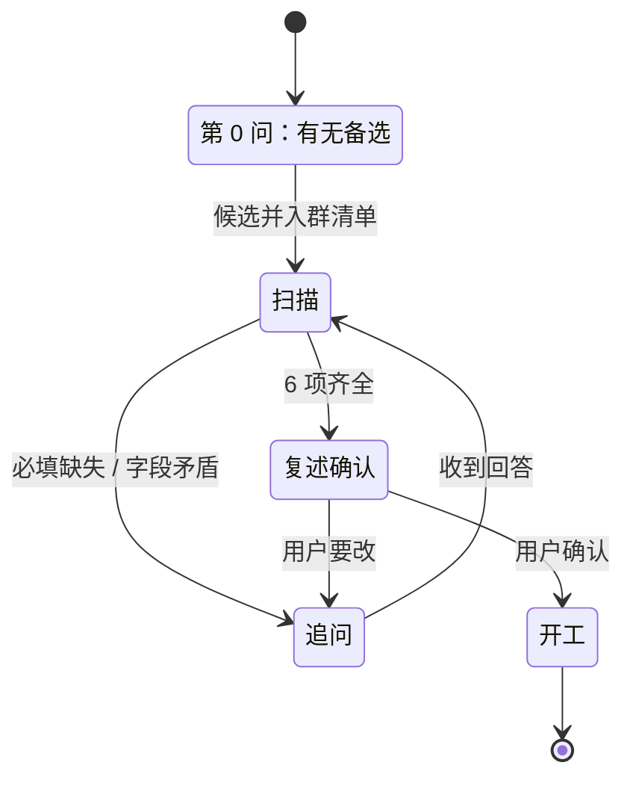

# 旅行推荐（travel-recommend）

## 这个 skill 解决什么

把「模糊的旅行愿望」变成**可验证、可分享、可复用**的推荐：

1. 先问「你们之前聊过想去哪、有没有备选」——用户提过的每个地方都必须进候选，并单独出一份完整方案；候选清单深挖前先给用户过目，**去过/不想去的整群换掉**（见 2.6）；
2. 再问清必填字段：缺一个就追问，问清并复述确认后才开工，不用示例数据硬编；
3. 硬筛掉不可行的目的地，再按权重打分；
4. **当同行者不在同一城市时，先问预算口径**：共同 / 各自 / 统一上限，分别算两人花费；不把一个人的上限强加给另一个人；
5. 交通票价只认实查，带查询时间、参考乘车日、适用日期与预售期状态；
6. **每个推荐的群都给完整方案**（行程 / 景点 / 交通 / 费用），并在群内城市同省或相邻省的前提下组群；
7. 交付一个离线可开的 HTML 文件夹：**每个景点 4–6 张图（地标/世遗 6–10 张，不设上限）**，逐张署名，每个方案带一张经纬度 SVG 路线图（可选高德 key 在线地图）；
8. **预算口径必须问清**：两个人距离不同、收入/上限不同，可以共同总预算、各自上限或统一上限；不能默认按「最吃亏者」一刀切；
9. **先过季节门槛再推荐**：夏天不推哈尔滨、雨季不推山区徒步；非当季的地方要么不列，要么写清「这个月为什么不适合」；
10. **用户点名的地方不设预算上限**：用户提过的候选照常出完整方案，按出行时段（元旦/春节溢价）把真实预计花费写出来，不用 ¥ 上限把它筛掉；
11. **两道子 agent 审核**：给用户确认名单前审一次「地方是否适合这个时间」，交付前再整体审一次，通过后才打包；
12. **地图让用户选**：默认离线 SVG；用户有高德 key 就切在线地图，没 key 不硬编。

## skill 结构

```
travel-recommend/
├─ SKILL.md                     # 方法论：输入契约 / 组群 / 行程 / 票价 / 验证
├─ assets/report-template/      # 报告模板（index.html + css + js + 占位图）
│  └─ README.md                 # 模板怎么填
├─ assets/attractions/          # 景点库（可查询的中国景点池）
│  ├─ attractions.jsonl         # 主库：名称/别名/省份/类型/标签/介绍/来源
│  ├─ sources.md                # 来源与可用性（构建脚本生成）
│  └─ README.md                 # 字段说明与用法
├─ prompts/                     # 子 agent 提示词（独立文件，不塞进 SKILL.md）
│  ├─ season-factcheck.md       # 给用户看名单前的季节/闭园/证件核查
│  └─ final-review.md           # 交付前的整体审核
├─ scripts/                     # Python（标准库 + requests/json5/Pillow，uv 直接跑）
│  ├─ build_attractions.py      # 抓榜单 → 解析 → 去重 → 打标签 → 补介绍 → JSONL
│  ├─ attractions.py            # 查库：按省/类型/标签/关键词，排除去过、找同类替代
│  ├─ fetch_rail_fares.py
│  ├─ fetch_images.py           # 精确文件名（File:xxx）
│  ├─ fetch_images_search.py    # 关键词检索抓图（多源并发 + 熔断）
│  ├─ fetch_geo.py              # 名称 → 经纬度（维基 + Wikidata）
│  ├─ optimize_images.py        # 图片压缩，控包体积
│  ├─ verify_report.py
│  ├─ package_report.py
│  ├─ calc_budget.py
│  └─ lib.py
```

模板自带全部前端代码，**skill 可独立分享，不需要附带任何成品报告**。

## 设计依据：吸收了什么，避开了什么

| 参考 skill | 吸收 | 避开 |
|---|---|---|
| mickpletcher/travel-planning | 硬约束表、先锁定再研究的分层、机票提前期建议、住宿按街区排序 | 它写死了单个人设（BNA/USD/美国护照），不可复用；无评分数学；无票价溯源 |
| mickpletcher/travel-research | 维度权重 + 预设、travel friction 独立计分、live-data 表带 confidence 列 | 权重只按「旅行风格」给，不跟用户自述兴趣校准；无多出发地；只输出文字 |
| chodolmu/travel-planner | 阶段化流水线、按请求规模裁剪模式、错误处理表、文件式交接 | 四个 agent 对简单请求过重；无价格时效纪律；只产 markdown，无成品 |
| travisjneuman/travel-planner | 按天数给节奏表、线路拓扑（线性/环线/枢纽）、预算占比、交通方式决策矩阵 | 模板化、无数据新鲜度、美元本位、打包清单喧宾夺主 |
| infometa/transport-plan | **价格三件套（查询时间 / 来源 / 订票入口）**、双源校验、confidence 标记、距离阈值选模式 | 只管交通；依赖美团连接器；两源都失败时没有降级说明；不看预售期 |
| dadmin88/travel-budget | 每个数字标 confirmed / estimate / placeholder、留机动、拒绝虚假精度 | 全文 7 行，无公式、无币种、无「人均 vs 总价」拆分 |

**共同缺陷 → 本 skill 的对策**

1. 缺输入就猜 → **缺必填就追问，问清并复述确认后才开工**；不允许用示例数据顶替。
2. 价格无溯源 → 每个金额必须携带 `{value, source, queried_at, valid_for, confidence}`。
3. 只算自己 / 默认取最差 → **先问预算口径**：各自上限分别算 `over_i`，共同预算才看合计；`max(在途)` 只用于提示「谁更辛苦」。
4. 只产文字 → 交付物是文件夹：`index.html + css + js + images`，双击可开。
5. 图片无授权 → 每张记录作者/许可/源链接，页面可见。
6. 内容同质化 → **写之前先查本地人攻略**（小红书/贴吧/知乎等不限），细节与提示都要有一手来源；官方数据与本地经验分开标注。
7. 按城市推荐 → **按地点群推荐**：邻近同质的城市合并成一条线，5 个候选风格必须互斥，群的大小随假期伸缩。

## 输入契约：缺字段必须问，问清前不产出

**硬规则（Gate）**：5 个硬字段 + 预算口径缺任意一个，就停在这里——不进硬筛、不打分、不排行程、不生成 HTML。
禁止用示例数据、常识或「合理猜测」补齐必填项。**先做后问 = 违规。**

### 第 0 问（先于任何检索：必须问，不能跳）

在硬筛和组群之前，必须问一句：

> 你和同行者之前有没有聊过想去哪？有没有已经心仪或备选的地方（哪怕只是「听说不错」）？

规则：

1. **用户报出的每个候选，必须进入地点群集合，且必须拿到一个完整方案**（行程 / 景点 / 交通 / 费用），不能因为分数低就悄悄删掉或只写一行点评。用户提过的地方，报告里没有 = 失职。
2. 候选与画像冲突（季节、天数、预算）时，**写在方案里的「为什么不推荐」**，而不是不出现。
   **预算上限不适用于用户点名的候选**：不因为超 ¥ 上限把它删掉或只给一行点评；按出行时段（元旦/春节/暑期溢价）算出真实预计花费，写清「按你的上限会超多少、超在哪」。用户自己决定加预算还是换地方。
3. 用户说「没有」也要确认一次（「确定没有已经想去的地方？」），再进入硬筛。
4. 候选数量不设上限；只有当新候选与已有群**风格冲突**时，才替换掉自评最低的同风格群，并说明替换关系。

**反例**：用户提过「想去长白山」，报告里几个群全是模型自己挑的——用户会觉得整份报告没听懂他。

### 必填字段（缺一即阻塞）

| 字段 | 卡住哪一步 | 缺失时的具体风险 |
|---|---|---|
| 出发地（城市 + 车站/机场） | 大交通、在途时长 | 无法判断高铁还是飞机，票价全是空谈 |
| 同行者所在地、人数、关系 | 会合成本、房型、预算分摊 | 会推荐一个只对你方便、对同伴残忍的城市 |
| 日期 + 可浮动天数 | 客流、票价、开售状态 | 元旦/平日价差可达数倍 |
| 假期长度（含在途） | 半径上限、行程密度 | 4 天排进 7 天的内容，全程在赶路 |
| 预算上限（人均 / 总） | 目的地筛选 | 先心动后超支，方案作废 |
| 预算口径：共同 / 各自 / 统一 | 多人不同上限时怎么算超支 | 默认按「最吃亏者」会把一个人的上限强加给另一个人 |

### 预算口径（多人必须问，不能默认取最差）

同行者不在同一城市、距离差很大时，先问一句：

> 你们两人的预算上限一样吗？想怎么算超支？
> A. 共同总预算（两人合计 ¥X）
> B. 各自上限（你 ¥x，她 ¥y）
> C. 统一上限（取较高者，但我会同时标出按较低者会超多少）

规则：

1. **默认不把 `max(在途, 花费)` 当成唯一结论**。它只适用于「共同预算/统一上限」，不能替用户决定谁该多花钱。
2. `per_person`：每个人各算 `cost_i` 与 `over_i = cost_i - cap_i`；可行性 = 所有人 `over_i ≤ 0`；排序先看 `max(over_i)`，再看两人合计。报告同时显示「谁超、超多少、超在哪」。
3. `shared`：总预算 ÷ 人数作为参考人均，但仍分列两人各自花费；不要让一个人替另一个人买单却不说明。
4. 预算口径写进 `meta.budgetMode`（`shared` / `per_person`）与 `costs.rail.labelA/labelB`；页面按侧标注「实查/估算」。

### 季节适用性（硬门槛，先于组群）

对每个候选先查「这个月份去是否成立」，再谈分数：

- 最佳月份、闭园/封山/停航期、雨季/台风/寒潮、极端温度；
- 季节限定项：冰雪大世界（12–2 月）、红嘴鸥（11–3 月）、雾凇、花期、草原；
- 需要边防证/预约/限流的（长白山南坡、部分边境口岸）。

判定写进群数据：`seasonStatus: "ok" | "off" | "closed"` + `seasonNote`。

- `off`（非当季）：不进首选；用户点名则保留并写「这个月为什么不适合、换季再来」。
- `closed`（闭园/停运）：直接标不可行，不排进行程。
- **反例**：7 月推哈尔滨冰雪大世界、12 月推草原、雨季推峡谷徒步——都是没做季节门槛。

### 地图模式（开工前问一次）

- **A. 离线 SVG（默认）**：零依赖、`file://` 双击可开，按经纬度自绘。
- **B. 高德在线（可选）**：用户自己申请 key，填 `meta.mapMode: "amap"`、`meta.amapKey`，必要时 `meta.amapSecurity`。需要联网，且 key 可能限制 `file://` 来源；加载失败时模板自动回退 SVG。
- 没 key 不要承诺在线地图；不要用高德/百度静态图 API 假装离线。
- **选了 B 但没给 key 属于「未完成确认」，必须单独追问一次**：
  > 你选的是高德在线，但我还没拿到 key。请把 web 端【JS API】的 key 发我（控制台 → 应用管理 → 添加 Key → 服务平台选「Web端(JS API)」）；如果你的 key 开了安全密钥，把 `securityJsCode` 也一并给我。
  > 如果你暂时没有 key，回一句「先用离线 SVG」，我就切离线示意图，并在报告顶部注明「本方案不含在线底图」。
  规则：不要默默回退 SVG（用户会以为有底图）、不要用静态图 API 冒充、不要在报告里写「可切换高德」却不给入口；只有用户明确同意降级才用 SVG。
- key 到手后自检一次：`meta.mapMode === "amap"` 且 `meta.amapKey` 非空才继续；`file://` 下高德可能因域名白名单失败，模板会回退 SVG，但**交付说明里必须写清「需联网、失败会回退示意图」**。
- 选择写进 `meta.mapMode`（`svg` / `amap`），并在报告顶部说明是否需要联网。

### 澄清循环（Clarify Loop）



0. **第 0 问**：先问「你们之前聊过想去哪、有没有备选」。答案里的每个地方都要进群清单并出完整方案（见上节）。

1. **扫描**：把用户原话填进画像槽位，已知标 `known`，其余标 `missing`（含推断但未经确认的）。
2. **每轮最多问 5 个**，按依赖顺序：出发地/同行者 → 日期/天数 → 预算 → 偏好。每个问题给示例答案，并允许回答「不确定」。
3. **只问会改变结论的**：必填全问；建议项仅在会影响排序时问（例：1 月行程里「避寒还是看雪」直接淘汰一半候选，必须问）。
4. **校验矛盾**：日期与天数对不上、预算 < 往返票价 × 1.8、同行者与出发地同城、返程晚于上班日——**指出来并追问**，不替用户改。
5. **复述确认**：6 项齐了，用 6 行复述（出发地 / 同行者 / 日期 / 天数 / 预算 / 预算口径），问「有要改的吗」。这一步不做完，不进下一步。
6. **落库**：把确认后的画像写入 `js/data.js`，报告里标「用户提供」；示例值必须替换干净。

**循环终止条件（五条同时满足）**

- 5 个硬字段 + 预算口径都有明确值；
- 无内部矛盾（日期↔天数、预算↔交通、同行者↔出发地、两人上限↔总预算）；
- 季节门槛已过（每个候选有 `seasonStatus`，非当季已说明）；
- 地图模式已确认：`svg`，或 `amap` 且已拿到 key（选了 amap 却没 key = 未确认，单独追问，不得默认回退）；
- 用户已确认复述。

任一条不满足 → 继续问下一个问题。**宁可多问一轮，不要交一份错方案。**

### 提问模板（可直接用）

```
先确认一件事：你和同行者之前聊过想去哪吗？有没有已经心仪或备选的地方？
（有的话我把它放进候选群，和别处一起比，单独出一份完整方案；没有就直接说「没有」。）

为了给出能直接订的方案，我还需要 5 个硬信息 + 2 个口径（其余我先按默认值，会在报告里列出来）：

1. 你从哪出发？城市 + 车站/机场（例：上海虹桥）
2. 还有谁一起、从哪出发？（例：朋友 1 人，广州南）
3. 哪几天？能前后浮动几天？
4. 一共几天（含往返在途）？
5. 人均预算上限（含大交通）？
6. 你们两人的上限一样吗？A 共同总预算 / B 各自上限（分别给）/ C 统一上限
7. 地图要哪种？A 离线 SVG（双击可开）/ B 高德在线（需要你自己的 web 端 JS API key）
   —— 选 B 请直接把 key 贴给我（开了安全密钥的话连 securityJsCode 一起）；只选 B 不给 key，我会再问一次，不会默默换成示意图

不确定的写「不确定」，我会按区间给并标注；但出发地、日期、天数三项必须是确定值，预算至少要给一个上限。
```

### 用户不肯说 / 说「随便」

- **「随便」不是答案**，也不能当作已确认。给 2–3 个具体选项让其挑：
  「4 天：A 泉州（人文 + 暖冬，人均 2.8k）／B 潮州（美食，人均 2.3k）／C 厦门（海景，人多且贵）」。
- 预算不肯给 → 给三档锚点（人均 1500 / 2500 / 4000）让其选档，并追问「两人的上限是否一样」。
- 预算口径不肯定 → 先按「各自上限相同」出两列，标注「这是分支，不是结论」，再追问谁的上限更高。
- 日期不定 → 至少要到「月份 + 天数」；连这个都没有，就不要查班次、不要报价。
- 同行者信息不明 → 可以先给两个分支的会合成本帮其决策，但必须标注「分支，不是结论」，并继续追问到明确答案。
- 用户明确说「先给我个示例」→ 可以跑示例，但报告顶部必须打 `示例数据` 徽章，并单列「哪些字段是占位、需要你替换」；用户一给真实值就整份重算，不得新旧混用。

### 建议字段

用户没提就填默认值，但必须在报告里列出「已假设」清单：
交通偏好与最长在途、兴趣权重、节奏体力、气候偏好、住宿档次与房型、饮食禁忌、必去/排除项、**已去过 / 不想去（在 2.6 候选回看里确认）**、返程硬约束。

默认值：中等节奏（日均 2 个大项 + 1 个小项）、双床房 1 间、人均餐饮 ¥100–150/天、市内交通 ¥30–45/天。

## 工作流

> **前置检查**：回到「输入契约」——5 个硬字段 + 预算口径齐全、无矛盾、季节门槛已过、且用户已确认复述。任一条不满足，停在这里继续问，不进入下面的步骤。

### 0. 定窗口
把日期换算成「D 天 N 晚」，标注是否为法定假期高峰（元旦/春节/五一/国庆溢价 20–50%）。

### 0.5 季节门槛（先于硬筛）
逐候选查「这个月份是否成立」：最佳月份、闭园/封山/停航、雨季/台风、极端温度、季节限定项。
写 `seasonStatus` 与 `seasonNote`；`closed` 直接淘汰，`off` 不进首选（用户点名除外）。
**不要推荐反季目的地**：7 月的哈尔滨冰雪大世界、12 月的草原、雨季的峡谷徒步，都属于没做这一步。

### 1. 硬筛（不满足直接淘汰，不进评分）
- 单程门到门 ≤ 假期的 30%（4 天行程 ≈ 单程 ≤ 8–9 小时）
- 气候与用户偏好冲突的排除（避寒就别推 -20℃）
- 4 天以内不排「换酒店 ≥ 2 次」的线路
- 预算上限 < 往返交通 × 1.8 的，先砍**模型自选**目的地；**用户点名的候选不砍**，改为算出真实预计花费并标注超支
- 季节 `closed` / 需要边防证但办不下来的，直接淘汰

### 2. 多出发地会合成本（本 skill 的核心差异）

对每个候选目的地 d、每位同行者 i：

```
time_i(d)   = 门到门分钟数（含接驳）
money_i(d)  = 往返票价（按该人的上限口径）
cost_i(d)   = 大交通 + 住宿分摊 + 餐饮 + 市内 + 门票 + 体验
over_i(d)   = cost_i(d) - cap_i(d)
```

**先看预算口径，再决定排序：**

- `per_person`（各自上限）：可行性 = 所有人 `over_i ≤ 0`；先按 `max(over_i)` 从低到高排，再看 `Σcost`。报告必须写「谁超、超多少、超在哪」，不能用一个平均值掩盖。
- `shared`（共同总预算）：看 `Σcost ≤ 总预算`，同时分列两人花费；`max(time_i)` 仍然用于提醒「谁在路上更久」。
- `uniform`（统一上限）：按较高上限算可行性，但额外标出「按较低上限会超多少」。

`worst_time(d) = max_i time_i(d)` 只用于「谁更辛苦」的提示，不再单独决定排序。
如果某位同行者的在途超过其声明上限，直接淘汰该目的地；如果只是预算不同，不要替用户砍掉——把差额写出来。

### 2.4 景点库：先查库，再联网，再谈推荐

`assets/attractions/attractions.jsonl` 是一个可查询的中国景点池（154 条起，字段见该目录 README）：
名称 / 别名 / 省份 / 城市 / 类型 / 标签 / 介绍（几十到两百多字，长短取决于来源）/ 来源链接。
**候选景点不该由模型凭印象临时挑**——先查库，库里有就直接用；库里没有才联网补，补完写回库。

两种用法，按场景选：

| 场景 | 命令 | 成本 |
|---|---|---|
| 没有明确目标，要做横向比较 | `--all --format compact` 全量入上下文 | 155 行 ≈ 8.9k 字符（介绍 60 字）/ 11.8k（120 字），一次读完不算负担 |
| 有目标、要排除、要校验 | 按省/类型/标签/关键词过滤 | 只输出命中的几条 |

```bash
uv run --no-project scripts/attractions.py                              # 概览：多少条、哪些省份/类型/标签
uv run --no-project scripts/attractions.py --all --format compact        # 全量精简表，直接贴进上下文
uv run --no-project scripts/attractions.py --all --format compact --intro-chars 120
uv run --no-project scripts/attractions.py --province 浙江 --type 山岳
uv run --no-project scripts/attractions.py --tag 摄影 --tag 秋色          # 多标签是「同时满足」
uv run --no-project scripts/attractions.py --exclude 丽江,平遥            # 用户去过 → 直接排除
uv run --no-project scripts/attractions.py --similar 泸沽湖               # 同省同类型替代（没有则逐级回退并提示）
uv run --no-project scripts/attractions.py --suggest 8 --seed 7          # 每类抽 1 个，取前 N 条
uv run --no-project scripts/attractions.py --missing-intro               # 还缺介绍的条目
```

规则：

0. **先选模式**：用户没给方向、或要「这个季节哪里值得去」这类横向判断 → 全量入上下文，由你自己比对；
   用户点名、说过去过、或要求核对某一类 → 走过滤，别把 154 行都塞进去。
1. **第 0 问之后、组群之前先查库**：用户点名的地名用 `--name` 查（含别名），能查到就带着它的类型与卖点进入组群；
2. **用户说「去过 X / 不想去 X」**：`--exclude X` 排除，再用 `--similar X` 找同省同类型的替代，按 2.6 的规则**整群替换**；
3. **库里没有的景点**：`build_attractions.py --enrich` 或人工联网补介绍，写回库并注明 `sources[]`；不要用模型记忆硬写；
4. **库只回答「是什么、在哪、为什么值得」**；门票、开放时间、预约规则、限流仍按第 5 节实查官方公告，不得把榜单当公告；
5. 库里的介绍要**改写成本次行程语境**（与风土人情呼应），不要原样复制榜单的排比句。

维护：`build_attractions.py` 负责抓取/解析/去重/打标签/补介绍；`sources.md` 记录来源与可用性，
被反爬拦下的站点（知乎、百度百科、今日头条）不要写进 `SOURCES`。


### 2.5 组群：推荐单位是「地点群」，不是城市

**推荐单位是「地点群」，不是城市；群的数量不固定。** 有几个真正成立的群就推几个（常见 4–7 个），不为凑数硬拼跨省组合，也不为某个固定数字砍掉合格的候选。同风格又挨得近的地方，必须合并成一条线一次玩完。
用户在第 0 问里提过的候选必须并进来，**每个群都要出一份完整方案**，不是一个首选 + 一堆点评。

1. **同风格去重**：只看海、只看古镇、只看雪山的目的地只能出现一次，多个合成一个群。
1.5 **地理邻近（硬约束）**：一个群里的城市必须**同省，或相邻省**，且任意相邻两站 ≤2 小时。跨半个中国拼出来的「群」不是群。
   - ✅ 西安 + 洛阳（陕 · 豫，相邻省，1h15）
   - ✅ 泉州 + 厦门（同为福建，25–32 分钟）
   - ✅ 长白山 + 延吉（同为吉林）
   - ❌ 青岛 + 成都（跨 3 省，10 小时）——这种只能作为「单城方案」，不能叫群
   - 群名要体现地理：写「闽南世遗群」而不是「泉州厦门群」。
2. **群内可串联**：任意相邻两站 ≤2 小时（高铁 / 城际 / 轮渡），且单向不折返。
3. **按假期定群大小**：

| 假期 | 群里几个地方 |
|---|---|
| ≤2 天 | 1 个 |
| 3–4 天 | 1 个主城（最多加 1 个 30 分钟内的卫星点） |
| 5–7 天 | 2–3 个 |
| 8 天以上 | 3–4 个，走环线（线性 / 环线 / 枢纽辐射） |

4. **互补不重复**：主城 + 一个气质不同的副城（泉州世遗 + 厦门海岛），不要两个同质城市。
5. **风格标签**：人文 / 美食 / 海滨 / 古都 / 冰雪 / 山水，每个群各占一个，避免「换了名字但体验一样」；群数量按实际成立的群走，不设固定值。
6. **反例（必须避免）**：青岛、威海、烟台并列成三个候选——全是看海，等于没得选。正确写法是
   **「胶东海岸群」：青岛 → 烟台 → 威海**，高铁 1.5–2 小时串联，再加烟台—长岛 / 威海—刘公岛 轮渡跳岛，5–7 天。
7. **群内交通要实查**：每一段给车次/船班、时长、票价（同样带查询时间），不能只写「很近」。

数据结构（`clusters`，一个群一条）：

```json
{
  "name": "闽南世遗群", "style": "人文 · 海港",
  "cities": ["泉州", "厦门"], "days": "3–5 天", "fit": [3, 5],
  "link": "泉州 ↔ 厦门北 动车 18–32 分钟，¥29–37",
  "seasonStatus": "ok", "seasonNote": "12 月白天 15℃ 左右，海风大但不冻手",
  "userPicked": false, "overBudget": null,
  "s": { "season": 4, "culture": 5, "food": 5, "access": 4, "link": 5, "cost": 4, "crowd": 4 }
}
```

`seasonStatus`：`ok` / `off` / `closed`；`userPicked: true` 的群即使超预算也保留，`overBudget` 写超出的金额（¥/人）。

**天数不匹配的群照样列出，但标「需 ≥N 天」并排除出首选**——它解决的是「下次长假去哪」，不是这次的答案。

### 2.55 子 agent 预审（给用户看名单之前，硬步骤）

群组完、**还没给用户过目、也还没查本地攻略**时，先派一个只读子 agent 做事实核对。

提示词在 `prompts/season-factcheck.md`：把出行窗口、同行者、候选群填进去，整份交给只读子 agent。不要自己删改核对项，也不要让它写行程。

**预审必须到景点级**，不能只给群级结论：每个景点回 `status`（open/off-season/closed/limited）、入口、停止入场时间、预约方式、季节错配。群级结论只是汇总；任何一个景点闭园或反季，都要在方案里显著提示。

规则：

1. `closed` 的群直接换掉；`off` 的群标注原因，除非用户点名。
2. 核查结果写进 `seasonStatus` / `seasonNote`，报告里可见。
3. 审核没过就不进入 2.6，避免让用户对着一份「7 月哈尔滨冰雪」的名单做选择。
4. 子 agent 只能读公开资料，不能替用户做偏好决定；不确定的写「待核」，不要编。

### 2.6 候选回看：让用户先划掉去过的地方（硬步骤）

群组完了、**还没开始查本地资料**的时候，先把这份清单原样交给用户，问三件事：

```
我按你的条件先圈了这几个群，动手深挖前想跟你确认：

1. 这里面哪些地方你（或同行者）已经去过？
2. 有没有完全不想去的？
3. 有没有想去、但没在名单里的？

群名｜风格｜城市组合｜建议天数｜一句话卖点
```

规则：

1. **「去过」是最强的排除信号**：整群替换，不是只换掉其中一座城——去过一次的人不会为了隔壁城市再飞一趟。换进来的候选要重新过 2.5 的地理邻近与风格约束。
2. 排除后要补足候选数量，别让名单缩水；用户提过的新地方按第 0 问的规则并进来。
3. 记录 `{place, reason: visited | dislike, replaced_by}`，报告里列一张「已替你排除」表，让用户看到你听进去了。
4. **这一轮不做 3.5 的本地资料检索**——给一个马上要被淘汰的群查攻略是纯浪费，等清单定稿再查。
5. 用户不回或不耐烦：可以按原清单继续，但报告里必须写明「未确认是否去过」，不要假装确认过。
6. 只列群的**一句话卖点**，先别摆分数——分数会压过用户自己的记忆和偏好。
7. **用户点名但超预算的群不参与替换**：保留，并在清单里直接写「预计人均 ¥X，超你上限 ¥Y」；只有风格冲突时才考虑替换，且优先保留用户点名的那个。

### 3. 打分（对群打分，1–5 分）

维度：季节体感 / 人文风土 / 美食密度 / 双城可达 / **群内串联** / 预算友好 / 人流舒适。
预设：人文美食 18/20/18/16/10/10/8；省心省钱 12/8/12/18/18/24/8；亲子自然 22/8/8/18/14/12/18。
用户给了兴趣占比就覆盖预设，并归一化到 100。

会合成本按**群内每一站**分别算；群内转场时间计入在途，不能当成「零成本移动」。
排序按 2 节的预算口径：`per_person` 先看 `max(over_i)`，`shared` 看总预算，`uniform` 看较高上限并标出较低上限的差额。
输出必须带一句「为什么不是第二名」，以及「这个群为什么不是两个候选」。

### 3.5 本地一手资料：先查再写（必做）

写风土人情和景点之前，先在公开网络上找**本地人或长期居住者**写的内容，形成参考再动笔。平台不限：小红书、贴吧、知乎、B 站、马蜂窝、大众点评、豆瓣、微博、地方论坛、本地公众号都行——**哪个网站写的无所谓，关键是“本地人视角”**。

每个目的地至少跑 4 条检索式：

- `<地名> 本地人 攻略` / `<地名> 避坑`
- `<景点> 几点去 人少` / `<景点> 哪个门进`
- `<地名> 老字号 本地人吃` / `<地名> 早餐 本地`
- `<景点> 预约` / `<景点> 门票 涨价`

要摘的是**可执行细节**，不是景点简介：

| 类别 | 例子 |
|---|---|
| 时间 | 几点开门、几点人最少、周几闭馆、演出/浮桥开合的固定场次 |
| 状态 | 今天是否开放、闭园/停航/索道检修原因、恢复时间、预约放票时间 |
| 动线 | 从哪个门进、打车落客点、站到景点实际多久 |
| 消费 | 本地价 vs 游客价、是否收现金、怎么排号 |
| 坑 | 假讲解、拉客、拍照收费、网图与实景差距 |
| 叫法 | 本地人对地名/食物的称呼（写进正文会更像人话） |

**交叉与标注（硬规则）**

1. 每条关键结论至少 **2 个独立来源**；只有 1 个 → 标「单一来源，待核」。
2. 门票、开放时间、预约规则以**官方公告**为准，本地帖子只补体验层信息。
3. 每条情报记 `{claim, source, date}`；报告里标「本地经验」，与「官方数据」分栏。
4. 超过 12 个月的攻略只当线索（价格与预约规则变得最快）。
5. 识别软广：通篇只推一家店、话术统一、没有缺点 → 降权或不用。

**落到成品的位置**

- 风土人情：用本地人的说法和生活细节替换百科句式；
- 景点卡片：`intro` 讲清「是什么 / 为什么值得」，`tip` 用检索到的可执行细节（错峰、入口、排号），且**不得与 intro 重复**；
- 行程：把「几点去人少」直接写进时间块，而不是笼统写「上午游览」。

可选的数据结构（报告底部按此列来源）：

```json
"localIntel": [
  { "claim": "开元寺 17:00 停止入场，15:30 后侧光最好", "source": "本地攻略 + 官方公告", "date": "2026-11", "confidence": "cross-checked" }
]
```

### 4. 行程编排与景点卡片

行程：每天 3 个时间块，标 duration；抵达日只排 1 个轻项目；返程日按车次倒推留 2 小时冗余；跨城移动日不排门票项目。

**两人不同出发地时，D1 与 Dn 必须写两套时间**：谁的航班/车次、几点落地、几点能到酒店。只按一个人的行程排，另一个人当天根本执行不了（例：A 上午落地、B 19:00 起飞 21:35 落地，却把 14:00「办入住、租雪具」写成两人共同动作）。写法：`"time": "12:00 / 21:50"`，`what` 里分别说明 A 与 B 做什么。

景点卡片必须写全九项，缺一项就是半成品：

| 项 | 要求 |
|---|---|
| 介绍 | 60–150 字，回答「是什么 / 为什么值得 / 看什么」，并**与上文风土人情呼应**（点出具体的历史、宗教、工艺或民俗，而不是「风景优美、值得一去」） |
| 图片 | **每景点 4–6 张，地标/世遗/5A 6–10 张，不设上限**（外观、内部、细节、不同时段、人流状态各来一张）。少于 4 张视为不合格；卡片图廊是网格，能排任意张数，不要因为「模板只放 3 张」就少抓 |
| 门票 | 价格 + 「以公告为准」；免费也要写明 |
| 建议时长 | 区间，如 2–2.5 h |
| 开放时间 | 有停止入场时间的要写：最后售票、停止入园、清场、周几闭馆 |
| 状态 | `open` / `off-season` / `closed` / `limited`（限流/维修/只开部分区域）；闭园写原因和恢复时间 |
| 入口 | 从哪个门进、哪个口近地铁/停车场；需要摆渡车/索道才能到的要写 |
| 怎么去 | 步行 / 公交 / 打车 + 大致耗时与费用 |
| 提示 | 1 条，**不得与介绍重复**，只写实用信息（错峰、机位、着装、排号、光线） |

**季节错配必须显著提示**：景点是季节限定（冰雪大世界、雾凇、花期、红海滩）而日期不在窗口内时，`status` 写 `off-season`，页面顶部出红色/黄色 alert，行程里不得排成主项；不能只在提示里写一句「夏季不开放」。反例：7 月把「冰雪大世界」排进哈尔滨行程，还写「可选」。`closed` 同理，直接不排。

反例：只写「门票 ¥55，建议 2 小时」再补一句「很值得去」——那是目录，不是介绍。

介绍与风土人情的衔接方式：风土人情里讲了「诸神共存」，开元寺的介绍就落到 24 尊飞天乐伎与东西塔；讲了「种蛎固基」，洛阳桥的介绍就解释牡蛎壳怎么把桥墩黏住。**两者不呼应，读起来就是两份互不相干的文档。**

### 5. 交通与票价（纪律最严的一段）

先按距离定模式：< 800 km 高铁优先；800–1500 km 比较；> 1500 km 飞机优先。
中国铁路必须查 **预售期**：12306 约 15 天，超出窗口返回空——这是「未开售」，不是「无车」。

每个价格对象：

```json
{
  "value": 503,
  "currency": "CNY",
  "class": "二等座",
  "source": "12306 queryTicketPrice",
  "queried_at": "2026-11-18T15:40+08:00",
  "valid_for": "2027-01-01",
  "confidence": "verified | estimated | placeholder",
  "note": "目标日未开售，取同车次 2026-11-25 实际售价"
}
```

规则：
- `verified` 才能写具体数字；机票/住宿/门票没实查就写区间 + `estimated`；
- 页面必须显示查询时间与适用日期，远期出行加一句「价格可能变动」；
- 车次必须核对**实际发车站**（同一条线常有虹桥/上海南/松江三个上车点，票价不同）；
- **金额不许手写**：`clusters[].note`、`plans[].why`、`costs.notes`、`verdict` 里出现的「人均 ¥X / 超 ¥Y / 余 ¥Z」必须由 `costs` 字段推出来，再用 `calc_budget.py` 反算核对一次。手写金额与字段打架是最常见的 blocker（例：`rail.B` 写 1265、文案说「在预算内」，实际 self-consistent 的数是 1042 且结论相反）；
- **票价必须逐项来自 transport 行**：`costs.rail.A/B` = 该人往返所有交通行之和（含群内动车/地铁），不要凭印象凑整；改一行车次就要同步改总额与所有引用它的文案。

### 6. 交付物：从自带模板生成，不要从零写页面

模板在 `assets/report-template/`：完整的 `index.html + css + js` + 4 张 SVG 占位图，**空数据也能直接打开**。
分享本 skill 时不需要附带任何成品报告——模板就是全部前端代码。

```bash
cp -r <skill-dir>/assets/report-template ./travel-report
```

```
travel-report/
  index.html          # 结构已定，通常不改
  css/style.css       # 视觉系统，改配色再动
  js/data.js          # ★ 只改这个：画像 / 每个群一份完整方案 / 行程 / 票价 / 署名
  js/app.js           # 渲染逻辑，通常不改（加地图时改这一段）
  images/             # 删掉占位图，放真实图片（4–6/景点，地标 6–10，不设上限）
  README.md           # 改法、来源、许可
```

**开箱三步**

1. `cp -r` 模板到输出目录；
2. 改 `js/data.js`：`meta.isTemplate`、`title`、`chips`、`clusters`、`plans` 换成真数据；
3. `uv run --no-project scripts/fetch_images.py <report-dir>/images manifest.tsv --sleep 4` 抓图进 `images/`、补 `credits`，再删掉 `placeholder-*.svg`。

模板自带两个保护：`meta.isTemplate: true` 时页面顶部挂红色横幅，`verify_report.py` 也会警告。
**改完数据务必置为 `false`**，否则等于对外发布占位内容。

硬性要求：
- **每个推荐的群，都要有一份完整方案**（行程 / 景点 / 交通 / 费用四项齐全），用户自己切换比较；只给 1–2 个群写详情、其余一句话点评 = 不合格；
- **每个方案必须带 `sources`**：数组，元素形如 `{ claim, source, date }`，至少 3–4 条，覆盖该群最关键的结论（开园/停止入场/预约放行时间/票价/限流）。页面「本方案情报来源」只在 `p.sources` 非空时渲染——不写这个数组，等于所有关键结论在页面上没有出处；
- 每个方案带一张**路线地图**（离线可开，见 6.5）；
- `file://` 直接可开（不用 ES module、不用 fetch 读本地 JSON）；
- 图片本地化，`` 必须写 `alt`，`loading="lazy"`；
- 图片署名逐张可见，附源页面链接；
- 费用表区分「实查/估算」，并提供人均与总额；
- 移动端 390px 无横向溢出（表格放滚动容器，网格子项 `min-width:0`）。

### 6.5 地图：先问用户要 SVG 还是高德 key

已核实（2026-11）：没有能「单文件离线 + 免 key」的现成瓦片方案。模板提供两条路，**开工前必须问用户选哪条**：

| 模式 | 适用 | 代价 |
|---|---|---|
| `svg`（默认） | 所有人；要双击即开、可分享 | 示意地图，不是真实底图 |
| `amap`（可选） | 用户有高德 JS API key、能联网 | 需要 key；`file://` 可能被域名白名单限制；加载失败自动回退 SVG |

**A. SVG（默认）**
1. `data.js` 给每座城、每个景点补 `geo: { lat, lng }`（小数 3 位够用）；
2. `app.js` 做等距圆柱投影：`x = lng * cos(lat0)`、`y = -lat`，再线性缩放到 `viewBox`；
3. 画三层：城市间路线（折线）、景点序号圆点、名称；点位太密时做小幅屏幕避让（`geo.jx/jy`），图注写「密集点位有避让」；
4. 文案必须写「示意地图 · 按经纬度投影绘制，非瓦片底图」；
5. 页面内不要出现 `http(s)` 图片引用，离线自检会拦。

**B. 高德在线（用户提供 key 时）**
1. `meta.mapMode: "amap"`、`meta.amapKey: "<用户的 key>"`，需要安全密钥时加 `meta.amapSecurity`；
2. 模板动态加载 `https://webapi.amap.com/loader.js`，画城市折线 + 景点序号标记；
3. 报告顶部写明「地图需联网」；加载失败自动切回 SVG 并在图注说明；
4. 没 key 就**先单独要 key**（见「地图模式」硬规则），用户明确说「先用离线」再降级为 SVG，**不要用静态图 API 假装离线**。

自检要加一条：`mapMode: "svg"` 时地图容器坐标齐全且无外链图片；`mapMode: "amap"` 时 `amapKey` 非空。

**备选地图方案（实测记录，2026-11-18）**

| 方案 | 需要什么 | 离线能否用 | 实测 |
|---|---|---|---|
| 离线 SVG（默认） | 无 | 是，`file://` 双击即开 | 始终可用；只是示意图 |
| 高德 JS API 2.0 | web 端 key（免费配额；**¥5 万/年是商用授权，个人非商用不需要**） | 否，需联网 | ✅ `file://` + Chrome 实测 `AMap v2.0` 加载成功、0 报错；`file://` 的 referer 白名单可能拦，失败自动回退 SVG |
| 天地图 WMTS | 免费注册 key | 否 | 未实测；瓦片为国内节点，`file://` 下同样受 referer 限制 |
| Leaflet + OSM/Carto 瓦片 | 免 key | 否（瓦片在线） | OSM 官方瓦片政策禁止批量下载；国内访问不稳，仅适合海外用户 |
| MapLibre + PMTiles | 自备 `.pmtiles` 文件 | 是（需随包带几 MB 文件） | 唯一「真离线底图」路线；需要预先切图，报告体积变大 |

**不要**用高德/百度「静态图 API」把一张 PNG 贴上去冒充交互地图；也**不要**为省事把 OSM 瓦片塞进「离线」报告——`file://` 打开就是白屏。

> 浏览器差异：omp 自带 headless WebKit 没有 TLS，无法加载任何 `https` 资源，**不能**用它验证在线地图；验证在线地图必须用真实 Chrome/Edge（`browser.open({ app: "C:\\Program Files\\Google\\Chrome\\Application\\chrome.exe" })`）。

### 7. 验证清单（交付前逐条过）

1. `uv run --no-project scripts/verify_report.py <report-dir>` 全绿（文件、图片、署名、重复图、外链、占位符）；
2. 打开页面，控制台 0 报错；
3. 所有有 `src` 的 `` 的 `naturalWidth > 0`（无 404）；
4. 切换每个方案 tab，景点数/费用总额随之变化；
5. 改人数/房价，总额按公式重算，且与 `calc_budget.py` 结果一致；
6. 390px 下 `document.documentElement.scrollWidth === innerWidth`；
7. 每个价格旁边能看到查询时间与「实查/估算」标记；
8. 每个景点都有 60 字以上介绍，且与风土人情呼应；有 `status`（open/off-season/closed/limited）与 `entry`（哪个门进）；非当季/闭园在页面显著报警，不能只藏在提示里；**图片 4–6 张（地标 6–10 张）**，`verify_report.py` 对少于 4 张出警告；
9. 风土人情与景点提示都有本地一手来源；关键结论 ≥2 个独立来源，门票/时间以官方公告为准；
10. 所有推荐群风格不重复，且**同一群内城市同省或相邻省、任一段 ≤2 小时**；邻近同质城市已合并成群，每段群内交通有时长与票价；
11. 车次发车站与真实站点一致（用 `fetch_rail_fares.py` 复核，别凭记忆）；
12. **每个推荐的群都有一份完整方案 tab**，切换后行程 / 景点 / 交通 / 费用齐全（不是只有首选有详情）；
13. 每个方案有一张路线地图：SVG 模式点位坐标齐全、与实际地理位置一致、密集点位有避让；amap 模式有 key 且标注需联网；页面内没有 `http(s)` 图片引用；
14. 用户提过的每一个候选（第 0 问的答案）都在群列表里，并且都拿到了完整方案；
15. 群清单在深挖前给用户过目过；用户说去过/不想去的地方已整群替换，报告里有「已替你排除」表（或明确标注「未确认是否去过」）；
16. 每个候选群都过了季节门槛：有 `seasonStatus`，非当季有 `seasonNote`，`closed` 的没进方案；
17. 预算口径已记录（`shared` / `per_person` / `uniform`）；各自上限时逐人写「超/余多少」，没有用平均值掩盖；
18. 用户点名的候选即使超预算也在列表里、有完整方案，并写清超出金额与原因；
19. 给用户确认名单前，有子 agent 预审结果（季节/闭园/交通/证件）；交付前有第二次整体审核记录；
20. 地图模式已问过用户；SVG 模式离线可开，amap 模式有 key 并标注需联网；**选了 amap 却没给 key 时判不合格——必须回问 key，或拿到用户明确同意后才降级为 SVG**。
21. 候选景点来过处：**先查 `assets/attractions/attractions.jsonl`**（`attractions.py --name`），库里没有才联网补；用户说过去过的地方用 `--exclude` 排除、`--similar` 找替代，并在报告「已替你排除」里写清。

### 8. 交付前二次审核 + 打包（硬步骤）

1. 先跑 `verify_report.py`，再按第 7 节逐条过一遍；
2. 派一个只读子 agent 做最终审核（reviewer），提示词在 `prompts/final-review.md`：把报告目录、预算口径、地图模式、用户候选、预审结果填进去，整份交给它。它负责找「反季推荐、闭园景区、超预算却没说、用户候选缺失、地图/图片坏链、来源不足」，并输出 `PASS` 或 `FAIL + 问题列表`。
3. `FAIL` 就修，修完重跑自检与审核；不允许「审核意见记下了，先交付」。
4. 全部通过后打包：
   ```bash
   uv run --no-project scripts/package_report.py <report-dir> <out.zip>
   ```
   打包脚本会先自检，并把 `.meta-*`、`credits.jsonl`、`manifest.json` 等中间文件排除。
5. 交付时同时给：zip 路径、目录路径、`index.html` 双击打开说明、哪些价格是实查/估算、地图是否需要联网。

## 工具链（脚本是唯一事实源）

`scripts/` 下的每个脚本都是**跑通过、修好过**的版本。下次遇到同类任务，先跑脚本；脚本报错就修脚本，不要在对话里手算一遍了事。

| 脚本 | 作用 | 典型用法 |
|---|---|---|
| `build_attractions.py` | 抓取公开榜单 → 解析 → 去重 → 打标签 → 维基补介绍，生成景点库 JSONL | `uv run --no-project scripts/build_attractions.py --enrich` |
| `attractions.py` | 查景点库：按省/类型/标签/关键词筛选，排除去过的地方，找同类替代 | `uv run --no-project scripts/attractions.py --similar 长白山` |
| `fetch_rail_fares.py` | 12306 车次 + 各席别实价；自动带 cookie、核对实际发车站；空结果时提示「可能未开售」 | `uv run --no-project scripts/fetch_rail_fares.py 上海虹桥 泉州南 2026-11-25 O` |
| `fetch_images.py` | Commons 批量抓图；限速、重试、md5 去重、生成可直接粘贴的 credits；`--keep-credits` 增量补图 | `uv run --no-project scripts/fetch_images.py images manifest.tsv --sleep 4` |
| `fetch_images_search.py` | **多源检索抓图**（Commons 搜索 / Commons 分类 / Openverse / 维基条目首图），各自限速 + 熔断 + md5 去重 + 署名；清单格式 `<slug>\|<检索词>\|<张数>` | `uv run --no-project scripts/fetch_images_search.py images manifest.tsv --sleep 4` |
| `verify_report.py` | 报告包静态自检（图片/署名/重复/外链/占位符/价格结构/季节与预算口径） | `uv run --no-project scripts/verify_report.py travel-report` |
| `package_report.py` | 先自检再打 zip，保留顶层目录，排除中间文件 | `uv run --no-project scripts/package_report.py travel-report out.zip` |
| `optimize_images.py` | 把图片压到可分享体积（长边 ≤1400、JPEG q82）；实测 74.4 MB → 20.6 MB | `uv run --no-project scripts/optimize_images.py travel-report/images` |
| `fetch_geo.py` | 按名称查经纬度（维基 `prop=coordinates` + Wikidata P625 兜底），输出可粘进 `data.js` 的坐标 | `uv run --no-project scripts/fetch_geo.py geo.tsv --out geo.json` |
| `calc_budget.py` | 与页面同公式的预算复算 | `uv run --no-project scripts/calc_budget.py --rail-a 1500 --rail-b 925 --stay 350 --nights 5 --rooms 1 --food 120 --days 6 --local 30 --tickets 150 --exp 100 --buffer 10 --people 2` |
| `lib.py` | 公共函数（UA、cookie、重试、md5、署名清洗） | 由其他脚本 import |

### 图片从哪来（2026-11-18 实测，按可用性排序）

`fetch_images_search.py` 内置四个免 key 图源，用 `--sources` 选择，默认全开：

| 源 | 免 key | 限速 | 擅长 | 备注 |
|---|---|---|---|---|
| `commons`（关键词搜索） | ✅ | 3.5 s | 地名 + 英文专名，命中率最高 | 同义词多试两次，别一次就放弃 |
| `commonscat`（`Category:<词>`） | ✅ | 3.5 s（与 commons 共用） | 地标、世遗有现成分类，一次能出十几张 | 分类名要用英文/专名，`Category:Gulangyu` 比中文更稳 |
| `wikipedia`（条目首图） | ✅ | 1.5 s | 冷门景点也有首图，构图通常最好 | 首图的作者/许可必须回查 Commons `extmetadata`，脚本已做 |
| `openverse`（聚合 Flickr/博物馆） | ✅ | 1.2 s | 风格多样，补充非 Commons 视角 | 偶发返回 0 条或长时间挂起，已加 25 s 超时 + 熔断 |

实测**不可用**（不要再试）：Library of Congress（Cloudflare 403）、The Met（API 2026-10 下线）、Art Institute of Chicago（Cloudflare 403）、Pexels / Pixabay / Unsplash（需 key，且要注明来源用户名）。国内图库（马蜂窝/携程/小红书）没有可用授权 API，抓到也**不能**直接用在 CC 报告里。

选源建议：先 `commons,commonscat` 打底（署名最干净），数量不够再加 `wikipedia`，需要不同风格再加 `openverse`。单源卡住时，用 `--sources commons --workers 5 --sleep 2.5` 反而更快。

### 已固化的坑（2026-11-18 实测，下次直接照做）

| 现象 | 根因 | 现在的做法 |
|---|---|---|
| 查远期车票脚本抛 `JSONDecodeError` | 12306 超出 15 天预售期时返回 HTML 页（200, text/html） | `fetch_rail_fares.py` 先看 content-type，非 JSON → 输出「未开售，不是无车」并退出 3 |
| 明明有车却报「没有匹配席别的车次」 | 12306 的 `from/to` 参数不再过滤，返回整片区域车次；脚本按 `fields[7]` 终到站过滤后全被丢弃 | 零匹配时打印「终到站分布」（苏州/太仓/张家港…），提示换邻近大站或改飞机 |
| 图片全写到 `C:\c\Users\...` | Windows 的 Python 把 POSIX 路径 `/c/...` 当成当前盘下的 `\c\...` | 一律用相对路径（`../travel-report/images`）或 `C:/Users/...`，不要用 `/c/...` |
| `uv run --no-project -c "…"` 报 unexpected argument | `uv run` 不接受 `-c` | 写 `uv run --no-project python -c "…"` |
| 补图把已抓的 `slug-1.jpg` 覆盖掉 | 编号固定从 1 开始 | `fetch_images_search.py` 从「已有最大编号 +1」续写 |
| 抓图任务跑十几分钟只出几张、像是卡死 | Openverse 请求会长时间挂起，长超时 × 重试把线程占满 | 超时压到 25s、重试 1 次；同一源连续 4 次异常即熔断，本批放弃该源 |
| 凑不到 4 张「同主题」实图 | 冷门景点在 Commons/Openverse 上没有足够照片 | 先扩大检索词/换源再试一轮；仍不足 4 张就**删掉该景点卡片**（`pois` 里不写），在 `days` 行程文字里保留；绝不用异地/异主题照片冒充 |
| 高德地图控制台报 `file://webapi.amap.com/theme/.../mark_bs.png` 404 | 高德默认 marker 图标是协议相对 URL，`file://` 下被解析成本地路径 | 城市标记必须传自定义 `content`（模板 `app.js` 已改），只用 `AMap.Marker({content})`，不要用默认图标 |
| 用 headless WebKit 验在线地图/HTTPS 一律失败（`TLS support is not available`） | omp 自带 WebKit 无 TLS | 在线地图与最终渲染验证一律用真 Chrome：`browser.open({app: "C:\\Program Files\\Google\\Chrome\\Application\\chrome.exe"})` |
| 方案 tab 点不动、总额不变 | 按 `dataset.plan` 匹配，但模板 tab 只有 `<span class="tab-name">` | 用 `.tab-name` 文本匹配后 `click()`；验证时必须逐 tab 读 `.row-total` |

**三条纪律**

1. **手工查过的东西必须回到脚本**：站点字段索引、`seat_types`、缺 cookie 返回空、Commons 限流的假图片——都已写进 Python 脚本。下次同类问题不会再错。
2. **修过的问题必须变成检查项**：图片只有 60 字节、`--keep-credits` 追加时 JSON 逗号、Windows 下 `/tmp` 不存在、`file://` 外链——都固化到脚本或验证清单。
3. **依赖用 PEP 723 写在脚本头部**：`requests` 负责 HTTP/重试，`json5` 解析 `data.js`，`Pillow` 校验图片是否可解码。uv 会按脚本元数据自动装依赖，不污染全局环境；不要手动 `pip install`。

脚本依赖：`uv`（会自动选择本机 Python 3.11+）。不再需要 curl / jq / node / Git Bash；Windows 的 `cmd` 或 PowerShell 也能直接调 `uv`。

## 反模式

- ❌ 缺必填字段却先出一版方案「供参考」——顺序错了，先问再做
- ❌ 用示例数据顶替用户的出发地/日期/预算，还当真结论
- ❌ 用户说「随便」就替他定日期和预算，不给出可选项
- ❌ 一次抛 12 个问题把用户问跑，或反复问已经答过的字段
- ❌ 手工查完就完事，不把查询逻辑沉淀成脚本
- ❌ 报「大概 500 块」而不给查询时间与来源
- ❌ 把 12306 空结果解释成「没有直达车」
- ❌ 用平均在途时间选会合城市
- ❌ 两个人距离差很大，却不问预算口径，直接按「最吃亏者」一刀切
- ❌ 把一个人的预算上限强加给另一个人，还说是「为你省钱」
- ❌ 7 月推哈尔滨冰雪、12 月推草原、雨季推峡谷——不看季节就推荐
- ❌ 景点关门/索道停运/周一闭馆，却照样排进行程
- ❌ 只写「从景区大门进」，不写哪个门、哪个口近地铁/停车场
- ❌ 季节限定的景点反季出现，只写一句「可选」，没有显著 alert
- ❌ 给用户看候选名单前，不派子 agent 核查闭园/封山/证件/极端天气
- ❌ 用户点名的目的地因为超预算被删掉，或只给一行「太贵了」
- ❌ 用户有高德 key 却硬塞 OSM 瓦片，`file://` 打开一片空白
- ❌ 没 key 却承诺在线地图，或用静态图 API 假装离线
- ❌ 用户选了高德在线却没给 key，不追问就直接出 SVG，或在报告里写「可切换高德」却不给入口
- ❌ 交付前不做第二次子 agent 审核，也不打包，只丢一个目录
- ❌ 把同质又邻近的城市并列成多个候选（青岛 / 威海 / 烟台只该是一个群）
- ❌ 群内交通只写「很近」，不给车次/船班、时长与票价
- ❌ 4 天行程塞 3 个城市，转场时间超过全程 20%
- ❌ 景点卡片只有门票和提示，没有介绍——那是目录不是内容
- ❌ 风土人情靠模型记忆或百科改写，不查任何本地人帖子
- ❌ 把单篇爆款笔记当事实，不做交叉来源
- ❌ 提示把介绍最后一句抄一遍，等于没写提示
- ❌ 景点只放 2–3 张图就收手（目标 4–6 张，地标 6–10 张）
- ❌ 因为「模板看起来只放 3 张」就少抓图——图廊是网格，能排任意张数
- ❌ 推荐的群只给 1–2 个完整方案，其余只写一行点评——用户没法自己比较
- ❌ 用户提过想去哪（长白山/雪乡/三亚），报告里没有它——先做后问的另一种形态
- ❌ 不确认用户去过哪，把人家去年玩过的城市再推荐一遍——浪费名额也浪费假期
- ❌ 用户说「去过西安」，只把西安换掉、留下洛阳——去过一次的人不会再为隔壁城飞一趟
- ❌ 为了凑数硬拼跨省组合（西安 + 厦门），车上时间比玩的时间长；也❌ 为了「5 个」这个数字砍掉本来成立的群
- ❌ 用 Leaflet / OSM 在线瓦片做「离线」地图，`file://` 双击打开一片空白
- ❌ 介绍写「风景优美、值得一去」，与前面的风土人情毫无关系
- ❌ 行程排满 4 个景点还声称「轻松」
- ❌ 图片直接热链外站，或用了 CC BY-SA 却不署名
- ❌ 交付一个需要 `npm install` 才能看的报告

## 输出格式

**输入不全时只输出澄清，不输出方案：**

```
还需要 3 个信息才能开工：
1. …（缺什么、为什么影响结论、给示例）
2. …
3. …
另外确认两个口径：A 预算怎么算（共同 / 各自上限 / 统一上限）；B 地图要离线 SVG 还是高德 key。
其余字段我先按默认值（会在报告里列明），你可以直接说「用默认」。
```

**输入齐全且已复述确认后：**

```
候选 N 群（风格互斥，含用户提过的全部候选；标季节状态；**每群一份完整方案**）：
1. <群名>｜<风格>｜<城市组合>｜<建议天数>｜<群内串联>｜<季节状态>｜<分数>
2. …
3. …
…
（用户点名的候选若超预算：保留，写「预计人均 ¥X，超上限 ¥Y」；因风格冲突替换的注明替换了谁）
已替你排除：<去过 / 不想去 / 同风格替换，各一行；没确认过就写「未确认是否去过」>
子 agent 预审：<每群 ok/off/closed + 一句结论>

结论：<群名>（<城市组合>）｜<D 天 N 晚>｜人均 <¥X>（<A 口径>）/ <¥Y>（<B 口径>）
预算口径：<共同 / 各自 / 统一>；<谁超多少，或两人都在上限内>
为什么是它：<3 条，含「为什么不是第二名」与「为什么这几城是一群」>
其余群：<各 2 行——一句话定位 + 完整方案在报告第几个 tab>
群内怎么走：<A → B 的车次/船班、时长、票价；哪天在哪座城>
怎么去：<去程/回程各 2–3 个班次，票价 + 查询时间 + 预售期状态>
怎么玩：<按天 3 个时间块，或按项目列时长>
花多少：<分项表：大交通/住宿/餐饮/市内/门票/体验/机动，标注实查或估算>
地图：<SVG 或高德；是否需要联网；每群一张的位置>
风险：<客流、天气、未开售、住宿溢价、闭园>
审核：<子 agent 预审 + 交付前复核的结论；FAIL 项已修>
交付：<zip 路径 + 文件夹路径 + 双击 index.html 说明 + 如何改数据>
```

## 变更记录

### 1.7.0（2026-11-18）

- **地图**：新增硬规则——用户选了高德却没给 key 时必须单独追问，不得默默回退 SVG；门禁、验证清单、反模式同步加条。补「五种地图方案实测表」；模板修掉 `file://` 下高德默认 marker 图标 404（改自定义 `content`）、城市标签用错 CSS 变量（`--fg` 不存在，改 `--accent`）、同城点位重叠（投影后自动双向推开）。
- **图源**：`fetch_images_search.py` 扩到四源（Commons 关键词 / Commons 分类 / Openverse / 维基条目首图），各自限速、异常熔断（连续 4 次放弃该源）、超时压到 25s、补图从「已有最大编号 +1」续写；新增「图源可用性」表与「实测不可用」清单。
- **图片标准**：每景点 4–6 张、地标 6–10 张、不设上限；`verify_report.py` 对少于 4 张出警告。
- **数据纪律**：金额不许手写，必须由 `costs` 字段经 `calc_budget.py` 反算；`costs.rail.A/B` 必须等于该人所有交通行之和；两人不同出发地时 D1/Dn 必须写两套时间；`plans[].sources` 变为必填并在自检里检查。
- **新脚本**：`fetch_images_search.py`（多源抓图）、`fetch_geo.py`（维基 + Wikidata 坐标）、`optimize_images.py`（74MB → 20MB 级压缩）。
- **修脚本**：`fetch_rail_fares.py` 区分「超预售期返回 HTML」与「无车」；12306 不再按 from/to 过滤时，零匹配给出终到站分布。
- **新增「已固化的坑」表**：Windows 下 `/c/...` 被当 `C:\c\...`、`uv run -c` 不合法、tab 选择器要用 `.tab-name`、headless WebKit 无 TLS 不能验在线地图等。

### 1.8.1（2026-11-18）

- **新增全量快照模式**：`attractions.py --all --format compact`，154 行 ≈ 8.9k 字符（介绍 60 字）。没有明确目标、要做横向比较时整表入上下文，比逐次过滤更省事；有目标/要排除时仍走过滤。SKILL 2.4 补「先选模式」一条。
- **修介绍错配**：维基补介绍原来只取搜索首条，`阿尔山柴河` 拿到了「柴河（辽宁那条河）」、`房山世界地质公园` 拿到了「石林风景名胜区」、`库车大峡谷` 拿到了维基列表页。改为标题三档校验（核心名相同 / 包含且占比≥0.5 或长度≥3 / 相似度≥0.75），错配宁可留空。
- **修省份误判**：`province_of` 原来双向子串匹配，`华山` 被 `九华山` 判成安徽；改为精确匹配优先、只允许「关键字在名称里」。
- **修名称截断**：`嵩山国家`、`亚龙湾国家`、`大连金石滩国家` 补剥 `国家/国家级` 后缀；`戈阳龟峰` 纠正为 `弋阳龟峰`。
- **合并重复条目**：长城/万里长城、昆明石林/云南石林、陕晋壶口瀑布/黄河壶口瀑布、苍山洱海/洱海、神农架/神农架国家级自然保护区、承德避暑山庄/及周围寺庙，别名保留可检索；160 → 154。
- **补 city 字段**：原来恒为空，现从地址提取地级市（97/154 有值），README 的字段说明与实际一致。
- **修 CLI 报告**：`--limit` 后不再把「匹配 N 条」写成过滤前总数；`--suggest` 帮助文案与实际行为（每类抽 1 个、取前 N）一致；零命中时提示筛选是精确匹配。
- **修文档可执行性**：`--tag 冰雪 --tag 摄影`（交集为 0）换成 `--tag 摄影 --tag 秋色`；`--similar 长白山`（吉林无同类、会回退到全国）换成 `--similar 泸沽湖`。

### 1.8.0（2026-11-18）

- **新增景点库**：`assets/attractions/attractions.jsonl`（160 条，字段：名称 / 别名 / 省份 / 城市 / 类型 / 标签 / 60–150 字介绍 / 来源）。用途：候选景点先查库，用户说「去过 X」时直接排除并给同类替代，不再由模型凭印象临时挑。
- **新增脚本**：`build_attractions.py`（抓公开榜单 → 解析 → 去重 → 规则打标签 → 维基补缺失介绍）与 `attractions.py`（按省/类型/标签/关键词查询，`--exclude` 排除去过、`--similar` 找同省同类型替代、`--suggest` 每类抽一个）。
- **新增 SKILL 2.4**「先查库，再联网，再谈推荐」与验证清单第 21 条。
- **来源可用性实测**：携程攻略、搜狐两篇榜单、买购网表格可用；知乎专栏 403、百度百科反爬挑战页、今日头条正文需 JS → 不写入来源。
